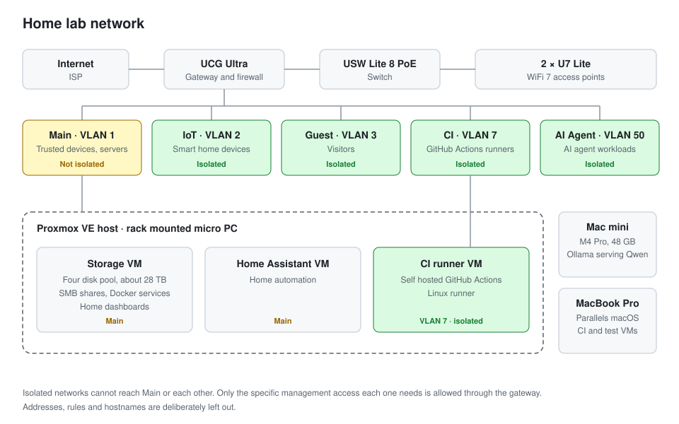

# Home lab

I have run some form of home lab for most of my career, starting with HP MicroServers that had iLO for out of band management, then a Windows host running Hyper-V virtual machines, and now a rack mounted micro PC running Proxmox. It is where I try things before I trust them, and through 2026 it was also the build and test environment for Patched, the products in my [endpoint-assurance](https://github.com/birdseeed/endpoint-assurance) and [macos-updater](https://github.com/birdseeed/macos-updater) repositories.

## The network

The network is UniFi throughout: a UCG Ultra as the gateway and firewall, a USW Lite 8 PoE switch and two U7 Lite access points. It is split into five VLANs, for trusted devices and servers, smart home devices, guests, CI runners and AI agent workloads, and every one except the main network is isolated, so it can reach the internet but not the home network or the other VLANs. Where something genuinely needs a path across, such as SSH from my Mac to the CI runner, it gets a firewall rule for that one port rather than a broad exception. The [network notes](docs/network-topology.md) have the detail.

## What runs on it

The Proxmox host runs three virtual machines, each with a single job:

| Virtual machine | What it does |
| --- | --- |
| Storage | A four disk pool of about 28 TB shared over SMB, plus Docker services including media and the dashboards displayed around the house |
| Home Assistant | Home automation |
| CI runner | A self hosted, isolated GitHub Actions runner for my own repositories |

## CI runners

A GitHub Actions job runs whatever code is in the workflow, so the Linux runner lives on its own VLAN, tagged through to the Proxmox host, and I tested from inside it that the household and management networks could not be reached. Running my own runners also cut the cost of GitHub hosted minutes.

For Patched I ran two kinds of self hosted runner. The Linux runner on Proxmox handled the service and licensing checks, and a persistent macOS ARM64 virtual machine on my M4 MacBook Pro, run under Parallels with four virtual CPUs, 8 GB of memory and a 100 GB disk, handled the native Swift and browser checks that need real macOS.

Labels alone are not enough to make sure a job lands on the right machine, so every job checked the exact runner name, operating system and architecture before checking out any code, refused to run as root, and recorded the runner and commit it ran against. Workflows only ran for pushes and pull requests from the repository itself, never from forks, and checkout did not leave credentials on the runner afterwards. For the riskier native tests I added a disposable macOS guest that was checked for the expected account, OS version, architecture and identity before any work ran, so a test could not silently run against the wrong machine.

## Local AI

I run local models on an M4 Pro Mac mini with 48 GB of unified memory, using Ollama to serve Qwen. I use it to compare running models locally with paying per token for hosted ones, and to keep work that should not leave the house on my own hardware.

## Looking after it

When I moved workloads between hosts I checked the storage mounts, scheduled timers and application health before and after, kept queues, configuration and data intact, and confirmed the backups were readable before switching anything over. I reuse hardware where I can, and I keep test environments separate from the Mac I use every day.
