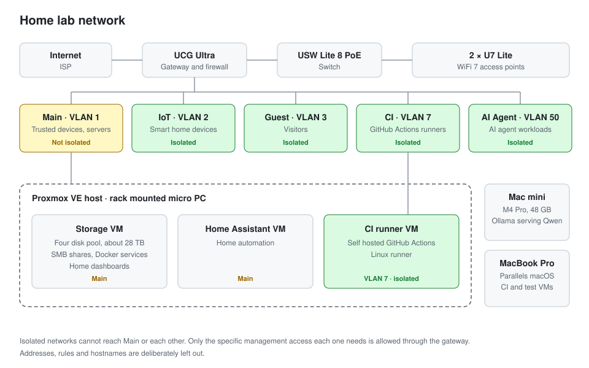

# Network topology

The network runs on UniFi: a UCG Ultra as the gateway and firewall, a USW Lite 8 PoE switch, and two U7 Lite access points. It is split into five networks, each on its own VLAN:

| Network | VLAN | Purpose | Isolated |
| --- | ---: | --- | --- |
| Main | 1 | Trusted devices and the home servers | No |
| IoT | 2 | Smart home devices | Yes |
| Guest | 3 | Visitors | Yes |
| CI | 7 | Self hosted GitHub Actions runners | Yes |
| AI Agent | 50 | AI agent workloads | Yes |

Everything except Main has UniFi network isolation turned on, so those networks can reach the internet but not each other or the home network. Where something genuinely needs a path across, such as SSH from my Mac to the CI runner, it gets a specific firewall rule for that one port rather than a broad exception, and the CI network is restricted to the DNS, DHCP and NTP it needs from the gateway.

The CI runner is the most important boundary. A GitHub Actions job runs whatever code is in the workflow, so the runner lives on its own VLAN, tagged through to the Proxmox host, and I tested from inside the runner that the household and management networks could not be reached.

The Proxmox host runs three virtual machines: storage, with a four disk pool of about 28 TB, SMB shares and Docker services; Home Assistant; and the Linux CI runner. The macOS CI and test virtual machines ran under Parallels on my MacBook Pro, and the Mac mini runs local models with Ollama.

Addresses, subnets, hostnames and the full firewall rule set are deliberately left out of this repository.
